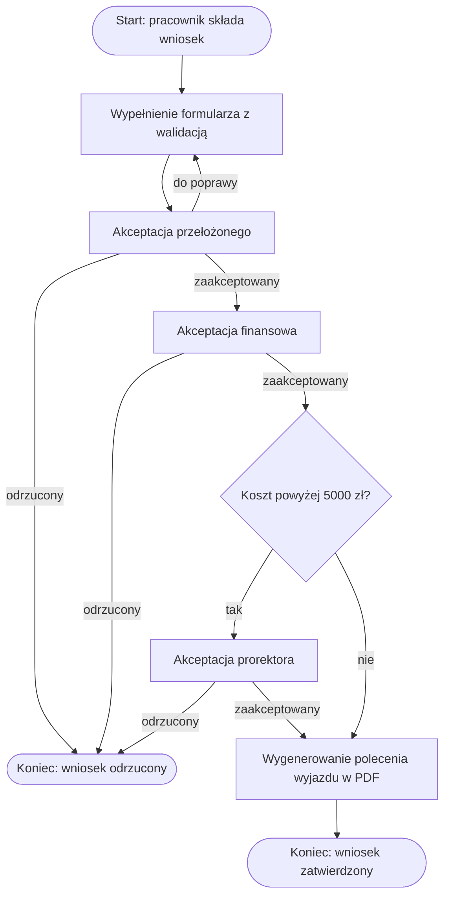

# Etap 2. Projekt rozwiązania: proces docelowy (TO-BE)

Proces docelowy dla wniosku delegacyjnego. Ten sam proces jest opisany w notacji BPMN w pliku [process/wniosek-delegacyjny.bpmn](../process/wniosek-delegacyjny.bpmn). Plik można otworzyć w [bpmn.io](https://demo.bpmn.io).

## Statusy wniosku

| Status | Kiedy wniosek go otrzymuje |
|---|---|
| Szkic | Pracownik zapisał formularz, ale jeszcze go nie złożył |
| Do akceptacji przełożonego | Po złożeniu wniosku |
| Do poprawy | Przełożony odesłał wniosek z komentarzem |
| Do akceptacji finansowej | Po akceptacji przełożonego |
| Do akceptacji prorektora | Po akceptacji finansowej, gdy koszt przekracza 5000 zł |
| Zatwierdzony | Wszystkie wymagane akceptacje zakończone |
| Odrzucony | Dowolny etap zakończył się odmową |

## Reguły procesu

- Brama kosztu: jeśli pole koszt szacowany przekracza 5000 zł, wniosek trafia do prorektora.
- Przełożony nie akceptuje własnego wniosku. System kieruje go do przełożonego wyższego szczebla (zakładanie P-1).
- Czas na decyzję: 2 dni robocze. Po tym czasie system wysyła przypomnienie, a po 4 dniach powiadamia kierownika działu. Wartości do potwierdzenia z klientem.
- Komentarz jest obowiązkowy przy statusach Do poprawy i Odrzucony.

## Pokrycie wymagań

| Wymaganie | Element procesu lub konfiguracji |
|---|---|
| W-01, W-02 | Formularz i walidacja (zadanie Wypełnienie formularza) |
| W-03 | Akceptacja przełożonego |
| W-04 | Akceptacja finansowa |
| W-05 | Brama kosztu i akceptacja prorektora |
| W-06 | Reguły powiadomień ([docs/03-konfiguracja.md](03-konfiguracja.md)) |
| W-07, W-08 | Logowanie SSO oraz role i uprawnienia ([docs/03-konfiguracja.md](03-konfiguracja.md)) |
| W-09 | Zadanie Wygenerowanie polecenia wyjazdu |
| W-12 | Reguła zastępstwa w konfiguracji obiegu |
